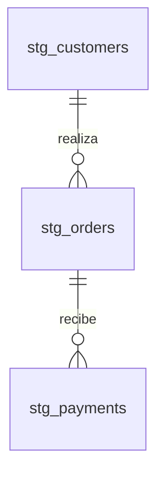

# Pagos por tipo y estado del envio

El modelo `models/marts/payments_by_method_and_status.sql` genera una tabla con
una fila por pareja `(payment_method, order_status)` y el importe `total_amount`
en AUD. Solo aparecen combinaciones con pagos. El estado disponible es el estado
actual del pedido, no un seguimiento independiente del transportista.

## Relaciones



Los pagos se unen a los pedidos por `order_id`; se agregan desde staging para
conservar los metodos como filas. Un pedido puede tener varios pagos, incluso del
mismo metodo. Las claves unicas y las relaciones se documentan y validan en
`models/staging/schema.yml`. Los `ref()` generan las dependencias en el DAG de dbt.

## Actualizacion elegida

Se reconstruye la tabla entera en cada ejecucion (`materialized='table'`). Un cambio
de estado mueve el dinero entre grupos y puede hacer desaparecer un grupo.
El proyecto no tiene timestamps de modificacion ni CDC que permitan detectar
esos cambios para un incremental fiable. Con el volumen de este taller, recalcular
es una estrategia sencilla y correcta.

Para actualizar una vez, desde la raiz del repositorio en PowerShell:

```powershell
.\scripts\refresh_payments.ps1
```

Para repetir mientras el proceso este abierto, esperando 60 segundos tras cada
ejecucion correcta (Ctrl+C para detener):

```powershell
.\scripts\refresh_payments.ps1 -Continuous -IntervalSeconds 60
```

El script ejecuta `dbt build --profiles-dir .`, incluyendo la recarga de los CSV,
los modelos y sus tests. Tambien carga clientes para validar sus relaciones con
pedidos desde la primera ejecucion. Un fallo detiene el proceso con
un error; no debe considerarse validada esa actualizacion. La frecuencia real es
el intervalo mas el tiempo de construccion. Los CSV tienen que recibir los cambios:
dbt no obtiene por si solo pedidos o pagos nuevos desde Jaffle Shop.
No se ha activado ningun proceso permanente ni tarea programada. En produccion,
un orquestador ejecutaria este job con el SLA de frescura acordado y fuentes reales.

## Semantica del dinero

Se suman los importes registrados, incluidos cupones y tarjetas regalo. No existen
campos de exito de cobro ni reembolsos; el resultado no representa efectivo bancario
liquidado ni ingresos netos. Un pedido returned conserva sus pagos en ese estado.
El contrato actual admite importes brutos no negativos, incluidos ceros. Si la
fuente incorpora reembolsos negativos, hay que revisar ese contrato y su test.
Staging convierte centimos a AUD; el agregado usa DECIMAL con dos decimales.

## Calidad y verificacion

- Identificadores obligatorios y unicos de pedidos y pagos.
- Relacion cliente-pedido y pedido-pago, sin referencias huerfanas.
- Metodo, estado e importe obligatorios y categorias permitidas.
- Clave compuesta del agregado unica e importes no negativos.
- Conciliacion exacta del total agregado con los pagos registrados.
- Verificacion funcional en una BD temporal: varios pagos por pedido, conversion
  a AUD, cambio de estado, desaparicion de grupos, pago nuevo e idempotencia.

```powershell
.\.venv\Scripts\dbt.exe build --profiles-dir .
.\.venv\Scripts\python.exe scripts\verify_payment_refresh.py
.\.venv\Scripts\dbt.exe docs generate --profiles-dir .
.\.venv\Scripts\dbt.exe docs serve --profiles-dir .
```

La descripcion completa del modelo esta en `models/marts/docs.md` y las columnas
y sus tests genericos en `models/marts/payments_by_method_and_status.yml`.
Los tests de conciliacion, granularidad e importes estan en `tests/`.
